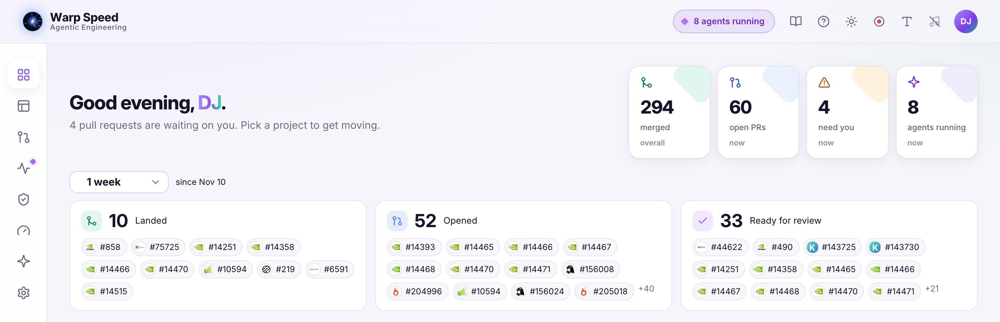

# Warp Speed

Warp Speed is a team of AI agents that carries open-source work from an open
issue to a merged pull request. No single agent does everything. Each agent
owns one stage, the way people on an engineering team do, and hands its work to
the next agent.

Every contribution starts with the **Triage agent**. It reads a project's open
issues, sets aside the ones someone else has claimed or that fall outside the
project's contribution rules, and picks the ones worth solving.

The **Research agent** then studies each issue the way a new teammate would:
the code paths involved, the project's contributing guide, and what reviewers
asked for on earlier pull requests. It hands the Build agent a plan, not a
guess.

The **Build agent** writes the change and its tests in an isolated checkout, so
many issues move forward side by side without stepping on each other. Before
anything leaves the machine, the **Review agent** checks the commit against the
same gates the project runs in CI. A change that fails goes back to the Build
agent, not to the project's reviewers.

Once the pull request is open, the **Repair agent** owns it. When a hosted check
fails, the Repair agent reads the log, reproduces the failure and pushes one
focused fix. The **Testing agent** runs the project's end-to-end suites on that
exact commit and keeps the evidence.

The **Nudge agent** watches over all of them. It reads every open pull request
on a schedule, and when one stalls, it wakes the agent that owns the next step.
The **Learn agent** closes the loop: every review outcome, merged or not,
becomes a rule the other agents follow on their next run, so each project gets
easier to contribute to over time.

Together these agents work dozens of pull requests across many projects at
once, each one racing to ready for review with every check green.

## Warp Speed-Assisted Contributions

These contributions were assisted by Warp Speed.

| Project | Contributions | Open | Merged | Merged % |
|--------------|---------------|------|--------|----------|
|  <a href="https://github.com/apache/airflow">Apache Airflow</a> | [37](https://github.com/apache/airflow/pulls/deepujain) | 1 | 14 | 37.8% |
|  <a href="https://github.com/apache/hadoop">Apache Hadoop</a> | [15](https://github.com/apache/hadoop/pulls/deepujain) | 3 | 5 | 33.3% |
|  <a href="https://github.com/apache/spark">Apache Spark</a> | [7](https://github.com/apache/spark/pulls/deepujain) | 0 | 4 | 57.1% |
|  <a href="https://github.com/apache/superset">Apache Superset</a> | [12](https://github.com/apache/superset/pulls/deepujain) | 2 | 10 | 83.3% |
|  <a href="https://github.com/brevdev/brev-cli">Brev CLI</a> | [2](https://github.com/brevdev/brev-cli/pulls/deepujain) | 0 | 2 | 100.0% |
|  <a href="https://github.com/openclaw/clawhub">ClawHub</a> | [26](https://github.com/openclaw/clawhub/pulls/deepujain) | 1 | 12 | 46.2% |
|  <a href="https://github.com/kubernetes-sigs/gateway-api">Gateway API</a> | [2](https://github.com/kubernetes-sigs/gateway-api/pulls/deepujain) | 1 | 1 | 50.0% |
|  <a href="https://github.com/NousResearch/hermes-agent">Hermes Agent</a> | [16](https://github.com/NousResearch/hermes-agent/pulls/deepujain) | 5 | 1 | 6.2% |
|  <a href="https://github.com/UKGovernmentBEIS/inspect_ai">Inspect AI</a> | [39](https://github.com/UKGovernmentBEIS/inspect_ai/pulls/deepujain) | 3 | 20 | 51.3% |
|  <a href="https://github.com/meridianlabs-ai/inspect_petri">Inspect Petri</a> | [7](https://github.com/meridianlabs-ai/inspect_petri/pulls/deepujain) | 1 | 2 | 28.6% |
|  <a href="https://github.com/Leaflet/Leaflet">Leaflet</a> | [6](https://github.com/Leaflet/Leaflet/pulls/deepujain) | 0 | 1 | 16.7% |
|  <a href="https://github.com/NVIDIA/NemoClaw">NemoClaw</a> | [227](https://github.com/NVIDIA/NemoClaw/pulls/deepujain) | 10 | 155 | 68.3% |
|  <a href="https://github.com/NVIDIA/NeMo-Agent-Toolkit">NVIDIA NeMo Agent Toolkit</a> | [3](https://github.com/NVIDIA/NeMo-Agent-Toolkit/pulls/deepujain) | 0 | 2 | 66.7% |
|  <a href="https://github.com/openclaw/openclaw">OpenClaw</a> | [36](https://github.com/openclaw/openclaw/pulls/deepujain) | 4 | 6 | 16.7% |
|  <a href="https://github.com/pytorch/pytorch">PyTorch</a> | [42](https://github.com/pytorch/pytorch/pulls/deepujain) | 19 | 6 | 14.3% |
|  <a href="https://github.com/NVIDIA/SkillEvaluator">SkillEvaluator</a> | [5](https://github.com/NVIDIA/SkillEvaluator/pulls/deepujain) | 0 | 5 | 100.0% |
|  <a href="https://github.com/NVIDIA/SkillSpector">SkillSpector</a> | [31](https://github.com/NVIDIA/SkillSpector/pulls/deepujain) | 0 | 29 | 93.5% |
|  <a href="https://github.com/NVIDIA-NeMo/Switchyard">Switchyard</a> | [10](https://github.com/NVIDIA-NeMo/Switchyard/pulls/deepujain) | 0 | 5 | 50.0% |
|  <a href="https://github.com/meridianlabs-ai/ts-mono">ts-mono</a> | [20](https://github.com/meridianlabs-ai/ts-mono/pulls/deepujain) | 0 | 16 | 80.0% |
| **Total Contributions** | **543** | **50** | **296** | **54.5%** |

**Total Contributions:** 543

**Success Rate:** 54.5% merged (296 of 543)

## Bootstrapping Projects

These projects are in their initial contribution phase and do not yet have a
merged contribution.

| Project | Contributions | Open | Merged |
| --- | ---: | ---: | ---: |
|  <a href="https://github.com/NVIDIA-AI-Blueprints/deep-researcher-agent">Deep Researcher Agent (AIQ)</a> | [3](https://github.com/NVIDIA-AI-Blueprints/deep-researcher-agent/pulls/deepujain) | 1 | 0 |
|  <a href="https://github.com/kubernetes/kubernetes">Kubernetes</a> | [2](https://github.com/kubernetes/kubernetes/pulls/deepujain) | 2 | 0 |
|  <a href="https://github.com/NVIDIA/Megatron-LM">Megatron-LM</a> | [7](https://github.com/NVIDIA/Megatron-LM/pulls/deepujain) | 4 | 0 |
|  <a href="https://github.com/NVIDIA/OpenShell">OpenShell</a> | [1](https://github.com/NVIDIA/OpenShell/pulls/deepujain) | 0 | 0 |
|  <a href="https://github.com/morluto/rea">REA</a> | [3](https://github.com/morluto/rea/pulls/deepujain) | 3 | 0 |
|  <a href="https://www.schedmd.com/">Slurm</a> | [3](https://support.schedmd.com/buglist.cgi?email3=deepujain%40gmail.com&emaillongdesc3=1&emailtype3=substring&list_id=418332&product=Slurm&query_format=advanced&resolution=---) | 3 | 0 |

## Non-Warp Speed Contributions

These contributions were not assisted by Warp Speed.

| Project | Contributions | Open | Merged | Merged % |
|--------------|---------------|------|--------|----------|
|  <a href="https://github.com/apache/avro">Apache Avro</a> | [1](https://issues.apache.org/jira/browse/AVRO-1419) | 1 | 0 | 0.0% |
|  <a href="https://github.com/apache/druid">Apache Druid</a> | [1](https://github.com/apache/druid/pulls/deepujain) | 0 | 1 | 100.0% |
|  <a href="https://github.com/elastic/beats">Elastic Beats</a> | [2](https://github.com/elastic/beats/pulls/deepujain) | 0 | 2 | 100.0% |
|  <a href="https://github.com/eBay/oink">eBay Oink</a> | [1](https://github.com/eBay/oink/pulls/deepujain) | 0 | 1 | 100.0% |
|  <a href="https://github.com/eBay/nvidiagpubeat">nvidiagpubeat</a> | Creator and maintainer | — | — | — |
|  <a href="https://github.com/apache/pig">Apache Pig</a> | [2](https://issues.apache.org/jira/issues/?jql=key%20in%20(PIG-1885%2C%20PIG-671)) | 0 | 2 | 100.0% |
|  <a href="https://github.com/apache/zeppelin">Apache Zeppelin</a> | [6](https://github.com/apache/zeppelin/pulls/deepujain) | 0 | 0 | 0.0% |
|  <a href="https://github.com/NICTA/scoobi">Scoobi</a> | [2](https://github.com/NICTA/scoobi/pulls/deepujain) | 0 | 0 | 0.0% |
| **Total Contributions** | **15** | **1** | **6** | **40.0%** |

## Reusable Skill

This repo also includes a reusable
[OSS Contribution README skill](skills/oss-contribution-readme/SKILL.md) for
creating README files like this one.

Use it to build a polished OSS contribution showcase with verified GitHub PR
counts, tracker patch submissions, official project logos, linked totals,
featured contribution tables, and screenshot-friendly formatting.
